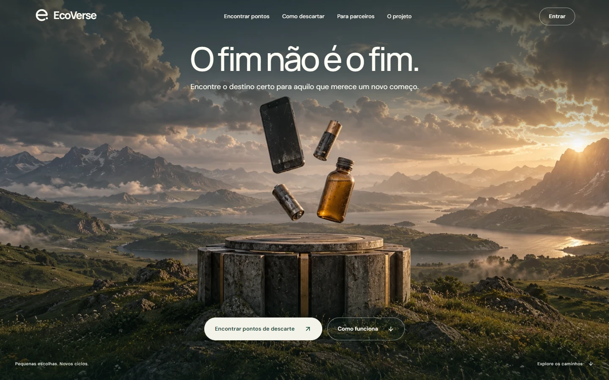
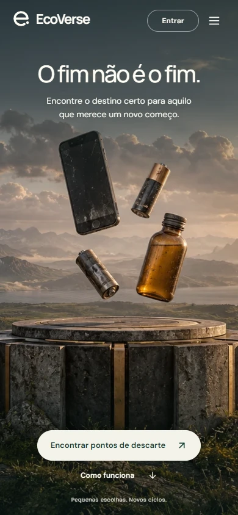
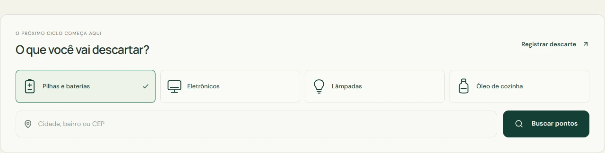
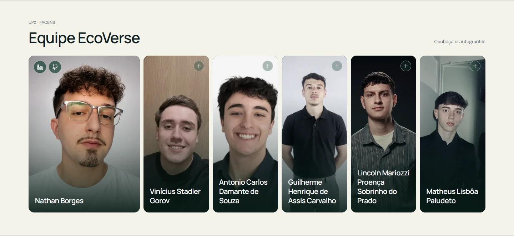

<p align="center">
  <picture>
    <source media="(prefers-color-scheme: dark)" srcset="web/public/ecoverse/ecoverse-logo-horizontal-white.svg" />
    
  </picture>
</p>

<h1 align="center">O fim não é o fim.</h1>

<p align="center">
  A pilha acabou. O celular ficou para trás. O óleo já fez sua parte.<br />
  <strong>O próximo passo é encontrar o destino certo.</strong>
</p>

<p align="center">
  <a href="#a-experiência">Veja a experiência</a> ·
  <a href="#da-sua-casa-ao-ponto-de-coleta">Como funciona</a> ·
  <a href="#quem-constrói">Equipe</a> ·
  <a href="docs/PRODUCTION.md">Publicar com Portainer</a>
</p>

[](#a-experiência)

<p align="center"><sub>Pilhas e baterias · Eletrônicos · Lâmpadas · Óleo de cozinha usado</sub></p>

## Cada material, um destino certo.

O EcoVerse aproxima quem precisa descartar de quem pode receber. Você escolhe o material, encontra um ponto de coleta e confere as condições antes de sair de casa. Depois da entrega, acompanha as etapas registradas pela rede parceira.

Sem depender de uma conversa perdida para descobrir onde levar. Sem tratar todos os materiais da mesma forma.

| Encontre onde levar | Registre sua entrega |
| --- | --- |
| Busque por material, cidade, bairro ou CEP. Veja o endereço, os horários e o que cada ponto aceita. | Informe os materiais, escolha um ponto compatível e apresente o QR na entrega. |
| **Acompanhe o caminho** | **Organize a rede** |
| Consulte o recebimento no ponto, o transporte e a chegada ao operador parceiro. | Pontos e operadores gerenciam parcerias, retiradas e lotes nas suas próprias áreas. |

## A experiência

Uma paisagem aberta. Objetos que já fizeram parte da rotina. A pergunta que fica é simples: para onde eles vão agora?

A página inicial parte dessa cena e leva direto à busca. No celular, o vídeo usa uma versão vertical. Quem prefere menos movimento recebe a mesma paisagem em imagem estática.

<p align="center">
  <a href="docs/readme/mobile.webp"></a>
  &nbsp;&nbsp;
  <a href="docs/readme/search.webp"></a>
</p>

<p align="center"><sub>Capturas da aplicação. Clique nas imagens para ampliar.</sub></p>

<details>
<summary><strong>Veja o que muda entre desktop e celular</strong></summary>

- Vídeos separados em 1920 × 1080 e 1080 × 1920, carregando somente a versão necessária.
- Cena centralizada, com texto e ações posicionados para preservar os objetos.
- Busca logo abaixo do hero, com seletores de material e localização.
- Navegação mobile, acesso por teclado e preferência por movimento reduzido.
- Poster mantido em caso de falha do vídeo ou economia de dados, quando detectável.

[Notas de implementação e testes visuais](docs/ecoverse/home-cinematica.md)

</details>

## Da sua casa ao ponto de coleta

| 01 · Escolha | 02 · Entregue | 03 · Acompanhe |
| --- | --- | --- |
| Selecione o material e procure um ponto que aceite o que você vai levar. | Registre a quantidade e apresente o QR ao chegar ao ponto. | Consulte as atualizações feitas pelo ponto e pelo operador parceiro. |

**Pilhas, eletrônicos e lâmpadas são registrados em unidades. Óleo de cozinha, em litros.** As condições de recebimento variam entre os pontos; confira antes de levar.

<details>
<summary><strong>O que o acompanhamento registra?</strong></summary>

O registro reúne a entrega, a confirmação no ponto, a movimentação da rede e o recebimento no destino parceiro. A chegada ao destino não equivale a um certificado de reciclagem.

O foco atual está nas quatro categorias apresentadas acima. Medicamentos, seringas, perfurocortantes e resíduos de serviços de saúde ficam fora do escopo.

</details>

## Um projeto de produto, interface e operação

O trabalho inclui a experiência pública e a parte que mantém a rede funcionando: contas por perfil, autenticação em duas etapas, imagens de perfil, notificações, histórico, parcerias, pedidos de retirada e lotes operacionais.

| Experiência web | Serviços e dados | Publicação |
| --- | --- | --- |
| Next.js 16 · React 19 · TypeScript | Fastify 5 · Prisma · PostgreSQL/PostGIS | Docker · GitHub Actions · GHCR |
| Tailwind CSS 4 · Manrope · DM Sans | Redis · S3 / SeaweedFS · Auth.js | Portainer · Nginx Proxy Manager |

<details>
<summary><strong>Como o código está organizado</strong></summary>

| Pasta | O que você encontra |
| --- | --- |
| [`web/`](web/) | Páginas, componentes, navegação e identidade visual. |
| [`api/`](api/) | Autenticação, regras de entrega, rede parceira e operações. |
| [`api/prisma/`](api/prisma/) | Modelo de dados e migrações versionadas. |
| [`docs/`](docs/) | Decisões, verificações e guia de publicação. |
| [`tools/`](tools/) | Geração de assets e preparação do ambiente. |

O navegador acessa a API por `/api/backend`, no mesmo domínio da aplicação. A comunicação entre os containers usa a rede própria do EcoVerse.

[Arquitetura](ARCHITECTURE.md) · [Decisões de implementação](docs/ecoverse/redesign-implementado.md)

</details>

## Rodar na sua máquina

Você precisa de Docker com Compose. Para trabalhar diretamente no código, use Node.js 24.

```bash
git clone https://github.com/borges-br/ecoverse.git
cd ecoverse
cp .env.example .env
docker compose up --build -d
```

Abra **[localhost:3000](http://localhost:3000)**. A configuração local cria sua própria base e não importa contas ou dados de uma publicação anterior. O arquivo `.env.example` contém valores de desenvolvimento; a configuração de produção fica separada. Para testar confirmação de conta e recuperação por e-mail, configure o SMTP e ative `EMAIL_ENABLED` no seu `.env`.

<details>
<summary><strong>Editar a aplicação com recarregamento automático</strong></summary>

```bash
docker compose -f docker-compose.yml -f docker-compose.dev.yml up --build -d
```

As pastas `web/` e `api/` são montadas nos containers. Os módulos instalados ficam em volumes de desenvolvimento próprios.

</details>

<details>
<summary><strong>Comandos de verificação</strong></summary>

Na pasta `web/`:

```bash
npm ci
npm run lint
npm run type-check
npm run build
```

Na pasta `api/`:

```bash
npm ci
npm run prisma:generate
npm run lint
npm run type-check
npm test
```

Os testes de domínio verificam categorias, quantidades, compatibilidade dos pontos e manutenção do histórico. O teste de publicação também verifica migrações, login e armazenamento em ambiente isolado. Consulte o [registro de validação](docs/ecoverse/publicacao-validacao.md) para os resultados efetivamente executados.

</details>

## Do repositório ao Portainer

O GitHub Actions verifica o código e publica duas imagens: **ecoverse-web** e **ecoverse-api**. O Compose de produção conecta a aplicação a banco, Redis e armazenamento próprios. Somente o serviço web entra na rede do proxy.

**Destino definido para a publicação: `mosfet.com.br`.** O domínio será direcionado ao EcoVerse na troca da aplicação; a nova stack não reutiliza o banco do VestGO.

[Abrir o guia de publicação →](docs/PRODUCTION.md)

<details>
<summary><strong>Por que o projeto ainda tem algumas referências ao VestGO?</strong></summary>

O EcoVerse evolui de uma base de doações desenvolvida anteriormente. A proposta atual é descarte responsável, com nova identidade e nova jornada. Parte dos nomes internos do modelo continua compatível com essa origem, como perfis técnicos e registros históricos.

A publicação do EcoVerse começa em um banco independente. O repositório anterior e seus volumes não precisam ser alterados para colocar esta aplicação no ar.

</details>

## Quem constrói

Seis integrantes trabalhando no EcoVerse como projeto **UPX / [Facens](https://facens.br/)**, conectando o desenvolvimento de software a uma questão concreta: orientar o descarte e organizar a rede que recebe esses materiais.



| Equipe | |
| --- | --- |
| [Nathan Borges](https://github.com/borges-br) | Vinícius Stadler Gorov |
| Antonio Carlos Damante de Souza | Guilherme Henrique de Assis Carvalho |
| Lincoln Mariozzi Proença Sobrinho do Prado | Matheus Lisbôa Paludeto |

O projeto reúne pesquisa do problema, definição da jornada, identidade visual, interface, serviços, dados e publicação.

## Para explorar mais

- [Identidade EcoVerse](docs/ecoverse/README.md)
- [Jornada e decisões de UX](docs/ecoverse/revisao-ux.md)
- [Homepage cinematográfica](docs/ecoverse/home-cinematica.md)
- [Publicação no Portainer](docs/PRODUCTION.md)
- [Validação da publicação](docs/ecoverse/publicacao-validacao.md)

<p align="center"><strong>EcoVerse</strong><br /><sub>Cada material, um destino certo.</sub></p>
